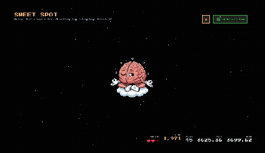

# Brain Arcade 🧠🕹️

<p align="center">
  
</p>

> **A retro arcade of thought-controlled minigames — proving neurotechnology is already here, accessible, and ready to hack.**

Brain Arcade is an open-source platform that connects consumer-grade EEG devices to playable minigames in your browser. Built with the cheapest available headset (Muse), this project demonstrates that neurotechnology isn't just deep-tech anymore — there's a layer that's **usable, accessible, and waiting for builders**.

## The Vision

This project serves **two audiences simultaneously**:

1. **Users** 👾 — Experience what's possible with neurotechnology _today_. See that brain-computer interfaces aren't science fiction — they're in your browser.

2. **Builders & Hackers** 🛠️ — Discover that building with neurotechnology doesn't require a PhD. Use pre-processed biomarkers as simple joystick controls (normalized 0-1 values) or dive deeper into signal processing pipelines.

The arcade setting makes it **playful and approachable** while the modular architecture makes it **serious and extensible**. Neurotechnology for everyone.

---

## Try It Now (No Hardware Needed!)

You can explore the entire platform using **mock mode** with real pre-recorded EEG data:

```bash
npm install
npm run dev
```

When connecting, choose **"Mock Mode"** to try all games without a Muse device. The mock data is real neural signals, so you'll get authentic behavior.

---

## Games Showcase

<p align="center">
  
  <br>
  <em>Sweet Spot: Float in a relaxation state by finding your cognitive sweet spot</em>
</p>

---

## Features

🧠 **Consumer-Grade EEG** — Uses Muse headbands (cheapest consumer EEG available) via Web Bluetooth

🎮 **Plug-and-Play Games** — Add new games without touching core files

🕹️ **Three Levels of Complexity** — From simple joystick controls to custom DSP pipelines

🔒 **Zero Data Collection** — Local-only processing, no neural data is ever saved or transmitted

🧪 **Mock Mode** — Develop and play with real pre-recorded EEG data (no device required)

🕹️ **Retro Aesthetic** — NES-style UI with 8-bit vibes

---

## Quick Start

### Installation

```bash
# Clone the repository
git clone https://github.com/itayinbarr/brain-arcade.git
cd brain-arcade

# Install dependencies
npm install

# Start development server
npm run dev
```

Open `http://localhost:5173/` in a Web Bluetooth-compatible browser (Chrome, Edge, or Opera).

### Browser Requirements

- Chrome, Edge, or Opera (Web Bluetooth support required)
- Safari and iOS devices are **not supported** (no Web Bluetooth API)

### Connecting Your Brain

**Option 1: With a Muse Device**

1. Power on your Muse headband
2. Click "Connect Muse" in the app
3. Select your device from the browser's Bluetooth dialog
4. Start playing!

**Option 2: Mock Mode (No Device)**

1. Click "Connect Muse"
2. Select "Mock Mode"
3. Experience real pre-recorded EEG data
4. Perfect for development and demos

---

## Architecture: Three Levels of Building

Brain Arcade is designed for **modularity and scalability**. Developers can work at different levels based on their expertise:

### Level 1: Game Developers (No Neuroscience Required)

Use pre-built **biomarker joysticks** — normalized 0-1 values representing cognitive states:

```jsx
import { useBiomarker } from "../../contexts/BiomarkerContext";

export function MyGame() {
  const { norm01 } = useBiomarker("frontal-midline-theta");

  // norm01 is a number from 0 to 1
  // 0.5 = baseline, higher = more cognitive control
  const playerY = norm01 * screenHeight;

  return <GameCharacter y={playerY} />;
}
```

**Available Biomarkers:**

- `frontal-midline-theta` — Cognitive control / focus
- `frontal-alpha-asymmetry` — Approach/withdrawal motivation
- `alpha`, `beta`, `theta`, `delta`, `gamma` — Band power averages
- `alpha-left`, `alpha-right`, etc. — Hemispheric band powers

### Level 2: Biomarker Users

Work directly with **processed EEG features** like band powers (alpha, beta, theta, delta, gamma):

```jsx
import { useProcessing } from "../../contexts/ProcessingContext";

export function MyGame() {
  const { bandPowers } = useProcessing();

  // bandPowers = { alpha: [ch1, ch2, ch3, ch4], beta: [...], ... }
  const leftAlpha = bandPowers.alpha[0];
  const rightAlpha = bandPowers.alpha[3];

  return <VisualizeBandPowers data={bandPowers} />;
}
```

### Level 3: Pipeline Builders

Create custom **signal processing pipelines** using raw EEG:

```jsx
import { useEEG } from "../../contexts/MuseContext";

export function MyGame() {
  const { rawEEG } = useEEG();

  // rawEEG = [TP9, AF7, AF8, TP10] in microvolts
  // Sampling rate: 256 Hz
  const customMetric = myCustomDSPFunction(rawEEG);

  return <UseCustomMetric value={customMetric} />;
}
```

**Full Processing Stack:**

1. **MuseContext** → Raw EEG data (256 Hz, 4 channels)

2. **ProcessingContext** → Welch PSD + band powers (~4 Hz updates)

3. **BaselineContext** → Session normalization (30s calibration)

4. **BiomarkerContext** → Cognitive markers (derived features)

5. **JoystickContext** → Game-ready 0-1 controls

---

## Adding a New Game

Games are **completely modular** — add yours without touching core files:

### 1. Create Your Game Folder

```bash
mkdir src/games/my-game
```

### 2. Build Your Game Component

Create `src/games/my-game/MyGame.jsx`:

```jsx
import { useBiomarker } from "../../contexts/BiomarkerContext";
import { useBaseline } from "../../contexts/BaselineContext";
import { useEffect } from "react";

export function MyGame() {
  const { ensureBaseline, isBaselineReady } = useBaseline();
  const { norm01 } = useBiomarker("frontal-midline-theta");

  useEffect(() => {
    ensureBaseline({ seconds: 30 }); // 30s calibration
  }, [ensureBaseline]);

  if (!isBaselineReady) {
    return <div>Calibrating baseline... relax for 30 seconds</div>;
  }

  return (
    <div>
      <h2>My Brain Game</h2>
      <p>Control value: {Math.round(norm01 * 100)}%</p>
      {/* Your game logic here */}
    </div>
  );
}
```

### 3. Register Your Game

Add to `src/games/games.config.js`:

```javascript
import { MyGame } from "./my-game/MyGame";

export const games = [
  // ... existing games
  {
    id: "my-game",
    name: "MY BRAIN GAME",
    description: "Control the game with your thoughts",
    component: MyGame,
  },
];
```

**That's it!** Your game appears in the arcade menu automatically.

For detailed contribution guidelines, see [CONTRIBUTING.md](./CONTRIBUTING.md).

---

## Privacy & Data Policy

🔒 **Zero Data Collection. Period.**

- **No neural data is ever saved** to disk
- **No data is transmitted** to any server
- **All processing happens locally** in your browser
- **Data exists only in memory** during your session

This is a hard rule for the project. Games that attempt to save or transmit neural data will not be accepted.

When you close the browser, all neural data is destroyed. Your thoughts stay yours.

**Read our full privacy policy:** [PRIVACY.md](./PRIVACY.md)

---

## Project Structure

```
/src
  /components
    - Layout.jsx              # Main UI layout
    - MuseConnector.jsx       # Device connection UI
    - BiomarkerJoystick.jsx   # Visual joystick component
    - StartScreen.jsx         # Retro start screen
    - NavBar.jsx              # Game navigation
  /contexts
    - MuseContext.jsx         # Raw EEG streaming (256 Hz)
    - ProcessingContext.jsx   # PSD + band powers
    - BaselineContext.jsx     # Session normalization
    - BiomarkerContext.jsx    # Derived cognitive markers
    - JoystickContext.jsx     # Game controls
    - QualityContext.jsx      # Signal quality monitoring
  /games
    /example-game            # Visualization demo
    /sweet-spot              # Relaxation floating game
    - games.config.js        # Central game registry
  /lib
    - signalProcessing.js    # DSP utilities
  /styles
    - retro.css              # 8-bit aesthetic
  - App.jsx                  # Main app + routing
```

---

## API Reference

### Hooks

#### `useEEG()` — Raw EEG Data

```javascript
const { rawEEG, isConnected, isMock, connectMuse, disconnectEEG } = useEEG();
```

- `rawEEG`: `[TP9, AF7, AF8, TP10]` in microvolts
- `isConnected`: Boolean device status
- `isMock`: Boolean indicating mock mode
- `connectMuse(options)`: Connect to device (`{ mock: true }` for mock mode)
- `disconnectEEG()`: Disconnect device

#### `useProcessing()` — Band Powers

```javascript
const { bandPowers, psd } = useProcessing();
```

- `bandPowers`: `{ alpha: [4], beta: [4], theta: [4], delta: [4], gamma: [4] }`
- `psd`: Power spectral density (Welch method, 2s window, 1s overlap)

#### `useBaseline()` — Calibration

```javascript
const { ensureBaseline, isBaselineReady, baseline } = useBaseline();
```

- `ensureBaseline({ seconds })`: Start calibration (default 30s)
- `isBaselineReady`: Boolean indicating baseline captured
- `baseline`: Baseline band power values

#### `useBiomarker(name, options)` — Cognitive Markers

```javascript
const { value, norm01, baseline } = useBiomarker("frontal-midline-theta", {
  range: 0.4,
});
```

- `value`: Current biomarker value
- `norm01`: Normalized 0-1 (0.5 = baseline)
- `baseline`: Baseline reference value
- `range`: Sensitivity parameter (default 0.4)

### Biomarkers & Joysticks (Updated)

- Biomarkers (BiomarkerContext `getBiomarker(name)`)
  - `frontal-midline-theta` — AF7/AF8 theta average (focus)
  - `frontal-alpha-asymmetry` — Alpha L-R difference (valence/approach)
  - `frontal-delta` — AF7/AF8 delta average (drowsiness)
  - `beta-alpha-ratio` — Beta/Alpha (frontal; stress proxy)
  - `theta-alpha-ratio` — Theta/Alpha (frontal; workload)
  - `theta-beta-ratio` — Theta/Beta (frontal; engagement inverse / fatigue)
  - `engagement-index` — Beta/(Alpha+Theta) (frontal; attention)
  - `relaxation-index` — (Alpha+Theta)/Beta (frontal; calm state)

- Joystick axes (JoystickContext `useJoystick(axis)` → `{ value01 }`)
  - `focus` — From `frontal-midline-theta` vs baseline
  - `alertness` — Inverse of `frontal-delta` increase (0=drowsy → 1=alert)
  - `drowsiness` — `frontal-delta` increase vs baseline
  - `stress` — `beta-alpha-ratio` (higher ⇒ more stressed)
  - `workload` — `theta-alpha-ratio` (higher ⇒ more load)
  - `engagement` — `engagement-index` (beta/(alpha+theta))
  - `relaxation` — `relaxation-index` ((alpha+theta)/beta)
  - `flow` — Composite of engagement, moderate beta, low delta, non-excessive theta
  - `frustration` — Composite of theta↑ + beta↑ with right-leaning theta asymmetry

Notes
- All axes gate on frontal signal quality to avoid artifacts.
- Most axes normalize against the session baseline (30s by default).
- Games can enable `autoAdjustBaseline` to adapt when users stick at extremes.

---

## Development

```bash
# Start dev server with hot reload
npm run dev

# Build for production
npm run build

# Preview production build
npm run preview

# Lint code
npm run lint
```

---

## Tech Stack

- **React 19** — UI framework
- **Vite** — Build tool & dev server
- **React Router** — Client-side routing
- **Tailwind CSS v4** — Utility-first styling
- **web-muse** — Muse EEG device library (bundled)

---

## Resources

- [Contributing Guidelines](./CONTRIBUTING.md)
- [Privacy Policy](./PRIVACY.md)
- [web-muse Documentation](https://github.com/itayinbarr/web-muse)
- [Web Bluetooth API](https://developer.mozilla.org/en-US/docs/Web/API/Web_Bluetooth_API)
- [Muse Headband](https://choosemuse.com/)

---

## License

MIT License — see [LICENSE](./LICENSE) for details.

This project is completely open source. Build on it, fork it, learn from it, break it, remix it.
