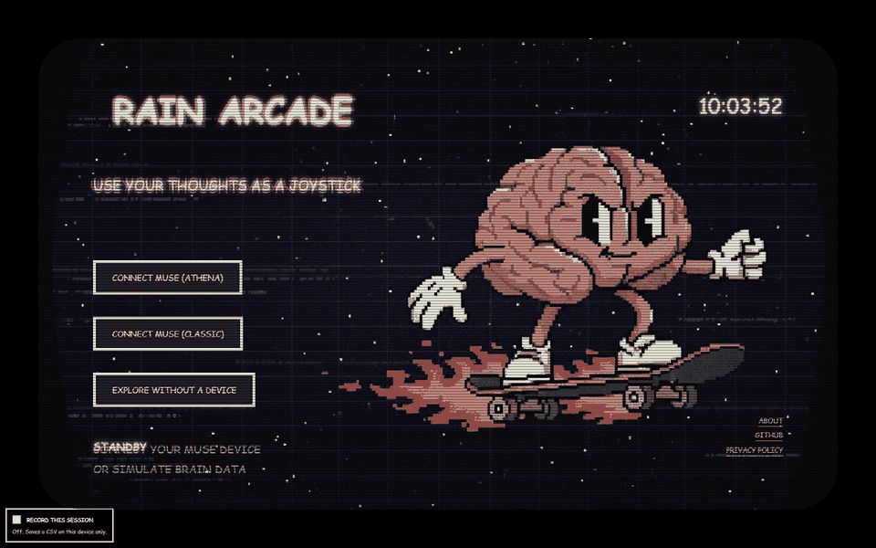
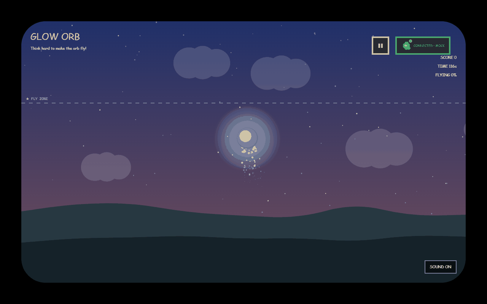
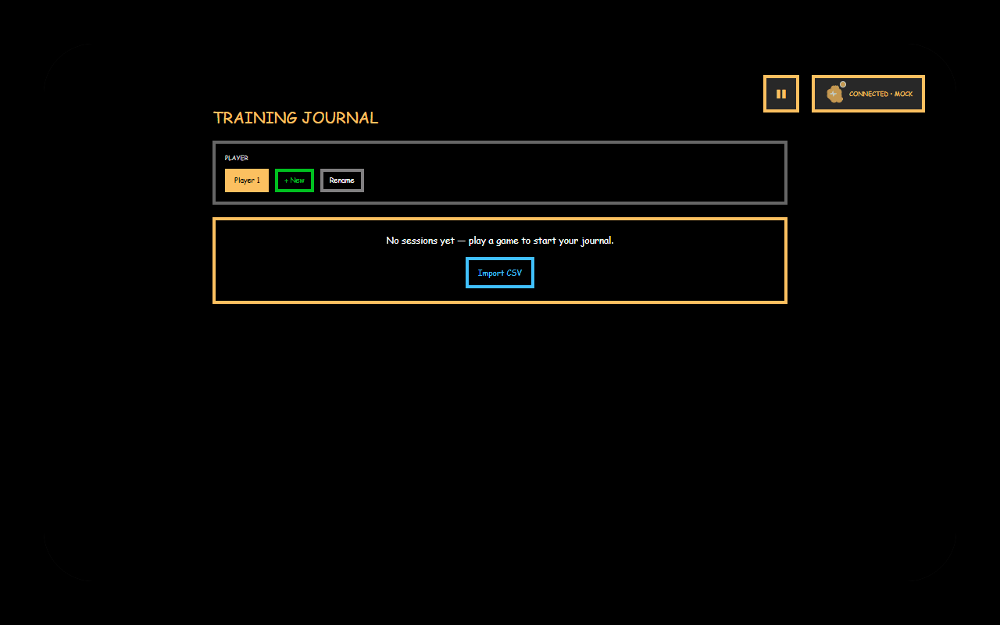
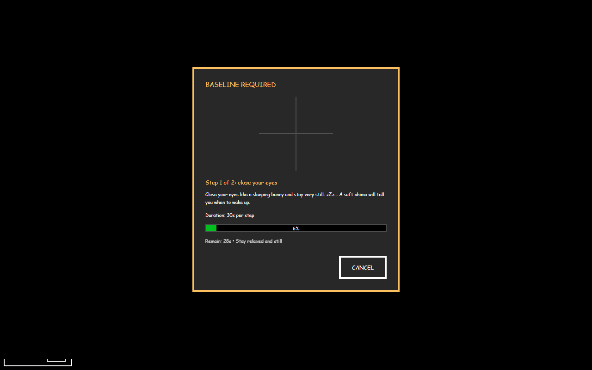
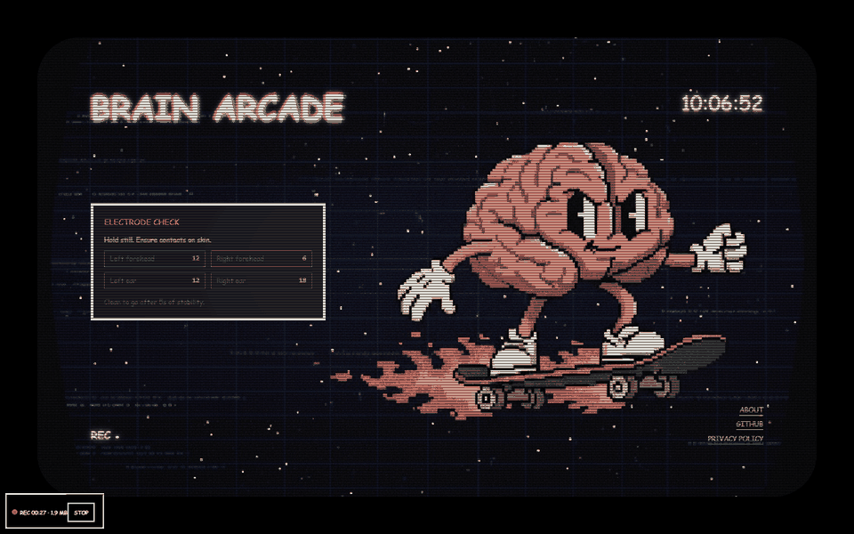
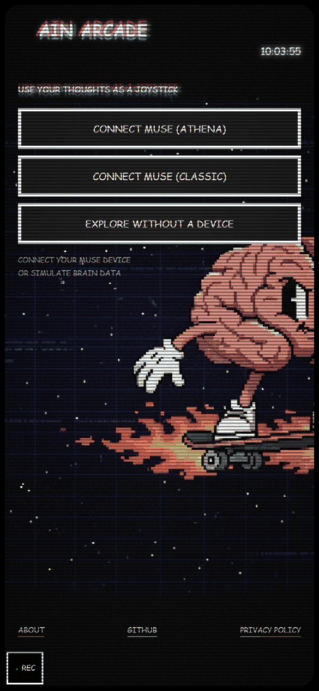
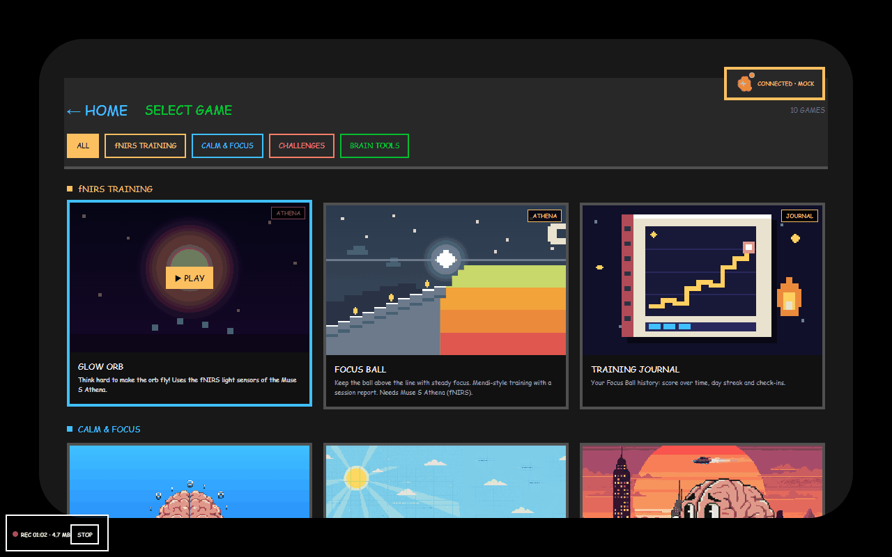

# Brain Arcade — Athena edition (this fork)

<p align="center">
  
</p>

Thought-controlled minigames in your browser. This fork adds full support for the **Muse S Athena (Gen 3)**, including its fNIRS light sensors. It also adds calm, Mendi-style training games, personal brainwave calibration, child profiles with a training journal, and a parent report. It works on a phone. Everything stays on your device.

**Try it now:** https://palo007.github.io/BrainArcade/

## What this fork adds

| Feature | What it does | Screenshot |
|---|---|---|
| **Muse S Athena over Web Bluetooth** | Connects the Athena (EEG, motion and fNIRS HbO/HbR) straight from Chrome. Reconnects by itself if the link drops. A phone relay is also available. | [Start screen](./docs/screenshots/01-start-desktop.png) |
| **fNIRS games** | **Glow Orb** and **Focus Ball**: think hard and the orb flies or the ball stays up. Mendi-style, with a session report. |  |
| **Training Journal** | Score over time, day streak and check-ins, per child. |  |
| **Two-phase calibration** | Peak Alpha Frequency from eyes closed, then eyes open. Personal frequency bands for each child. |  |
| **Session recording** | Opt-in, on-device, crash-safe CSV. Mind Monitor compatible, with Athena optics. Opens in [mind-monitor.com/Chart.php](https://mind-monitor.com/Chart.php). See [where the file goes](#session-recordings-where-the-file-goes). |  |
| **Child profiles and history** | One profile per child. Session history, trends, CSV export and import. | [Journal](./docs/screenshots/06-journal.png) |
| **Parent report** | Band timeline, topomap and a plain-language summary. Print or save as PDF. | (in game over screen) |
| **Phone first** | Installable PWA. Fullscreen, rotation, portrait and landscape layouts. No desktop-only block. |  |
| **Drift-proof signal mechanics** | Slow signal drift no longer pins a game at 0. Bad-signal pauses really pause. Stuck or unusable sessions are flagged, not scored. Covers the original games too. See [Signal mechanics](./docs/SIGNAL-MECHANICS.md). | — |

> **How the brain signal becomes a game control, and what we changed compared with the original project:** see [docs/SIGNAL-MECHANICS.md](./docs/SIGNAL-MECHANICS.md).

### Gallery

| | |
|---|---|
| <br>Game list | <br>Glow Orb in action |
| <br>Calibration, step 1 of 2 | <br>Phone portrait |

## Try it

1. Open https://palo007.github.io/BrainArcade/ in Chrome (Android or desktop).
2. With a headset: tap **CONNECT MUSE (ATHENA)**.
3. No headset: tap **EXPLORE WITHOUT A DEVICE**, then **USE SIMULATED REAL-TIME DATA**.

Run it locally: `npm install`, then `npm run dev`.

## Install on Android

Open the site in Chrome. Tap the menu (three dots), then **Install app**. This makes a WebAPK with a home-screen icon and fullscreen mode.

Why not a Trusted Web Activity (Bubblewrap)? We built one. It works, but Chrome disables Web Bluetooth inside TWAs ("Web Bluetooth API globally disabled"). The headset cannot connect there. So the Chrome install is the recommended way.

## Session recordings: where the file goes

Recording is **off** by default. To turn it on, tick **RECORD THIS SESSION** on the start screen before you connect the headset.

### How it works

1. **While you record**, the data goes into a private storage area inside the browser (the Origin Private File System). Only Brain Arcade can open it. You cannot see it in a file manager. Nothing is uploaded. The file is written to disk every 20 seconds, so a crash or a closed tab loses 20 seconds at most.
2. **Recording stops** when you tap **STOP** or when the headset disconnects.
3. A box opens: **RECORDING SAVED ON THIS DEVICE**. It has three buttons:
   - **SAVE FILE** copies the CSV to your normal downloads folder.
   - **SHARE** opens the system share menu (phones only), for example to send the file to e-mail or Google Drive.
   - **DELETE** removes the private copy.

**Important:** after you tap SAVE FILE (or SHARE), tap **DELETE** too. Otherwise the private copy stays in the browser and uses storage. The saved file in your downloads folder is not changed.

### Where SAVE FILE puts the file

| Device | Browser | Folder |
|---|---|---|
| Android phone | Chrome or the installed app | `Internal storage/Download`. Open the **Files** app, then **Downloads**. |
| Windows PC | Chrome or Edge | `C:\Users\<your name>\Downloads` |
| Mac | Chrome or Edge | `~/Downloads` (Finder, then **Downloads**) |
| Linux | Chrome | `~/Downloads` |

If you changed the browser's download folder, or if the browser asks where to save, the file goes there.

The headset needs Web Bluetooth. Safari (Mac) and all browsers on iPhone/iPad do not have it. Use Chrome or Edge.

### File name and format

`mindMonitor_YYYY-MM-DD--HH-MM-SS_brainarcade.csv`, for example `mindMonitor_2026-10-10--10-21-02_brainarcade.csv`.

The file is one CSV in the [Mind Monitor](https://mind-monitor.com/) format. You can open it at [mind-monitor.com/Chart.php](https://mind-monitor.com/Chart.php), in a spreadsheet, or in Python. Athena fNIRS (optics) data is in the columns `Optics1` to `Optics16`. Game start and end are marked as `/Marker/1` and `/Marker/2`.

### If you forget to save

The next time you open Brain Arcade, a box asks **RECOVER LAST RECORDING?**. Tap **SAVE FILE** to get the file, **DELETE** to remove it, or **LATER** to ask again next time.

The private copy is lost if you uninstall the app or clear the site data for Brain Arcade. Save the file first.

### Limits

- Recording stops when the device storage is almost full. The file is kept up to that point.
- If the browser has no private file storage, the recording is kept in memory and stops after 30 minutes.

## Alpha peak: how to measure it and see changes over time

Your **alpha peak** (peak alpha frequency, PAF) is the frequency where your brain makes the most alpha waves
when you rest with your eyes closed. Adults are usually near 10 Hz, children lower (about 7-9 Hz). The app
uses it to fit the colour bands to you. It is a personal reference, **not a score and not a medical test**.

### Measure it (about 1 minute)

1. Put on the headband. Wet the sensors a little if contact is poor. Hair must not sit under the sensors.
2. Connect the headband and start a game. The calibration window opens.
3. Tap **START** (not QUICK). Only START measures a new alpha peak.
4. **Step 1:** close your eyes and stay still for 30 s. Do not talk, chew or frown.
5. A soft chime plays. **Step 2:** open your eyes and look at the cross for 30 s.
6. The game starts. The result is saved for the active player.

QUICK reuses the last alpha peak and only does the eyes-open part. It does not add a point to the history.
Demo mode ("EXPLORE WITHOUT A DEVICE") saves nothing.

### See the result

Open **Training Journal** (in the game list) and pick the player. The panel **ALPHA PEAK OVER TIME** shows:

| Part | What it means |
|---|---|
| Summary text | Latest peak, and "Stable" or "Changed by ..." since the first calibration |
| Trend chart | One pink dot per calibration, by date. The pink bar is the spread (where most measurements fell). The cyan ring is a second estimate (centre of gravity). The green band is ±0.5 Hz around the first value: changes inside it are normal day-to-day variation |
| Alpha spectrum | Alpha power above the background. Pink line = latest, grey dashed = first. A taller, sharper hump = clearer alpha |
| Alpha reactivity | How much alpha drops when the eyes open. Above the dashed line (1.2x) = good contact. Below = check the headband fit |
| All calibrations | Table with every value, and **EXPORT CSV** |

### Test plan

1. Do one full calibration (START) today. Check the journal: you see one point and the text "Latest alpha peak".
2. Do a second full calibration right after. The two values should be within about 0.5 Hz. If not, check the fit.
3. Repeat on 3 or more different days, at a similar time of day. After 3 points over 14 days or more, the summary also shows a slow trend in Hz per month.
4. If you see "No clear alpha peak found": sit still, relax the face and jaw, keep the eyes closed for the whole step, and try again.

The history is stored only in this browser on this device (up to 60 calibrations per player).
Clearing the browser data deletes it. Use EXPORT CSV to keep a copy.

## Privacy

All processing runs in your browser. Brain data, profiles and recordings stay on your device. Nothing is uploaded. Recording is off unless you turn it on. See [PRIVACY.md](./PRIVACY.md).

## Credits and license

Fork of [itayinbarr/brain-arcade](https://github.com/itayinbarr/brain-arcade), licensed **AGPL-3.0**. This fork keeps the same license. Thanks to the original author and contributors. Details of what changed: see the git history.

---

## Original project

The text below is the upstream README, unchanged.

# Brain Arcade 🧠🕹️

<p align="center">
  
</p>

> **A retro arcade of thought-controlled minigames - proving neurotechnology is already here, accessible, and ready to hack.**

[Brain Arcade](https://brain-arcade.io/) is an open-source platform that connects consumer-grade EEG devices to playable minigames in your browser. Built with the cheapest available headset (Muse), this project demonstrates that neurotechnology isn't just deep-tech anymore - there's a layer that's **usable, accessible, and waiting for builders**.

## The Vision

This project serves **two audiences simultaneously**:

1. **Users** 👾 - Experience what's possible with neurotechnology _today_. See that brain-computer interfaces aren't science fiction - they're in your browser.

2. **Builders & Hackers** 🛠️ - Discover that building with neurotechnology doesn't require a PhD. Use pre-processed biomarkers as simple joystick controls (normalized 0-1 values) or dive deeper into signal processing pipelines.

The arcade setting makes it **playful and approachable** while the modular architecture makes it **serious and extensible**. Neurotechnology for everyone.

---

## Try It Now (No Hardware Needed!)

You can explore the entire platform using **mock mode** with real pre-recorded EEG data:

```bash
npm install
npm run dev
```

When connecting, choose **"Explore without a device"** to try all games without a Muse device. The mock data is real neural signals, so you'll get authentic behavior.

---

## Features

🧠 **Consumer-Grade EEG** - Uses Muse headbands (cheapest consumer EEG available) via Web Bluetooth

🎮 **Plug-and-Play Games** - Add new games without touching core files

🕹️ **Four Contribution Levels** - From joystick-only games to raw EEG pipelines

🔒 **Zero Data Collection** - Local-only processing, no neural data is ever saved or transmitted

🧪 **Mock Mode** - Develop and play with real pre-recorded EEG data (no device required)

🕹️ **Retro Aesthetic** - NES-style UI with 8-bit vibes

---

## Quick Start

### Installation

```bash
# Clone the repository
git clone https://github.com/itayinbarr/brain-arcade.git
cd brain-arcade

# Install dependencies
npm install

# Start development server
npm run dev
```

Open `http://localhost:5173/` in a Web Bluetooth-compatible browser (Chrome, Edge, or Opera).

### Browser Requirements

- Chrome, Edge, or Opera (Web Bluetooth support required)
- Safari is not **not supported** (no Web Bluetooth API)

### Connecting Your Brain

**Option 1: With a Muse Device**

1. Power on your Muse headband
2. Click "Connect Muse" in the app
3. Select your device from the browser's Bluetooth dialog
4. Start playing!

**Option 2: Explore Without a Device (No Device)**

1. Click "Explore Without a Device"
2. Experience real pre-recorded EEG data
3. Perfect for development and demos

---

## Contribution Levels

Brain Arcade is designed for **modularity and scalability**. Contribute at any of four levels - pick what matches your skills and needs:

### Level 1: Joystick-Only Games (No Neuroscience)

Use pre-built **cognitive joysticks** - simple 0–1 values (map to 0–100%) that represent states like focus, engagement, or relaxation. You do not need to touch biomarkers or signal processing.

```jsx
import { useJoystick } from "../../contexts/JoystickContext.jsx";

export function MyGame() {
  // Choose an axis like 'engagement', 'focus', or 'relaxation'
  const { value01 } = useJoystick("engagement", {
    range: 0.4,
    autoAdjustBaseline: true,
  });

  const power = Math.round(value01 * 100); // 0..100
  return <div>ENGINE POWER: {power}%</div>;
}
```

Notes

- Joysticks auto-normalize against a session baseline and gate on signal quality.
- You can rely on the built-in calibration flow in the UI, or call `useBaseline().ensureBaseline({ seconds: 30 })` if your game needs to force calibration.

### Level 2: Biomarker Users/Builders (Basic Neuroscience)

Use or add **biomarkers** that joysticks are based on. Biomarkers expose raw values plus normalized helpers.

```jsx
import { useBiomarker } from "../../contexts/BiomarkerContext.jsx";

export function MyGame() {
  const { norm01, value, baseline } = useBiomarker("frontal-midline-theta");
  return <div>FOCUS: {Math.round((norm01 ?? 0.5) * 100)}%</div>;
}
```

Common biomarkers

- `frontal-midline-theta` (focus/control)
- `engagement-index` (beta/(alpha+theta))
- `relaxation-index` ((alpha+theta)/beta)
- Ratios and bands: `beta-alpha-ratio`, `theta-alpha-ratio`, `alpha`, `beta`, `theta`, etc.

### Level 3: Preprocessed EEG Users

Use **preprocessed features** like band powers directly from the processing pipeline.

```jsx
import { useProcessing } from "../../contexts/ProcessingContext.jsx";

export function MyTool() {
  const { bandPowers } = useProcessing();
  // bandPowers[ch].alpha, .beta, .theta, .delta, .gamma
  return <SpectrumBars data={bandPowers} />;
}
```

### Level 4: Raw EEG & Custom Pipelines

Access **raw EEG** and design your own DSP pipeline.

```jsx
import { useEEG } from "../../contexts/MuseContext.jsx";

export function MyDSP() {
  const { rawEEG } = useEEG(); // [TP9, AF7, AF8, TP10] @ 256 Hz
  const metric = myCustomDSPFunction(rawEEG);
  return <Metric value={metric} />;
}
```

**Full Processing Stack:**

1. **MuseContext** → Raw EEG data (256 Hz, 4 channels)

2. **ProcessingContext** → Welch PSD + band powers (~4 Hz updates)

3. **BaselineContext** → Session normalization (30s calibration)

4. **BiomarkerContext** → Cognitive markers (derived features)

5. **JoystickContext** → Game-ready 0-1 controls

---

## Privacy & Data Policy

🔒 **Zero Data Collection. Period.**

- **No neural data is ever saved** to disk
- **No data is transmitted** to any server
- **All processing happens locally** in your browser
- **Data exists only in memory** during your session

This is a hard rule for the project. Games that attempt to save or transmit neural data will not be accepted.

When you close the browser, all neural data is destroyed. Your thoughts stay yours.

**Read our full privacy policy:** [PRIVACY.md](./PRIVACY.md)

---

## Project Structure

```
/src
  /components
    - Layout.jsx              # Main UI layout
    - MuseConnector.jsx       # Device connection UI
    - BiomarkerJoystick.jsx   # Visual joystick component
    - StartScreen.jsx         # Retro start screen
    - NavBar.jsx              # Game navigation
  /contexts
    - MuseContext.jsx         # Raw EEG streaming (256 Hz)
    - ProcessingContext.jsx   # PSD + band powers
    - BaselineContext.jsx     # Session normalization
    - BiomarkerContext.jsx    # Derived cognitive markers
    - JoystickContext.jsx     # Game controls
    - QualityContext.jsx      # Signal quality monitoring
  /games
    /example-game            # Visualization demo
    /sweet-spot              # Relaxation floating game
    - games.config.js        # Central game registry
  /lib
    - signalProcessing.js    # DSP utilities
  /styles
    - retro.css              # 8-bit aesthetic
  - App.jsx                  # Main app + routing
```

---

## API Reference

### Hooks

#### `useJoystick(axis, options)` - Cognitive Joysticks

```javascript
const { value01 } = useJoystick("engagement", {
  range: 0.4,
  autoAdjustBaseline: true,
});
```

- `axis`: one of the documented joystick axes (see below)
- `value01`: normalized 0–1 control (map to 0–100%)
- `range` (optional): sensitivity around baseline (default ~0.4)
- `autoAdjustBaseline` (optional): gently shifts center if user sits at extremes

#### `useEEG()` - Raw EEG Data

```javascript
const { rawEEG, isConnected, isMock, connectMuse, disconnectEEG } = useEEG();
```

- `rawEEG`: `[TP9, AF7, AF8, TP10]` in microvolts
- `isConnected`: Boolean device status
- `isMock`: Boolean indicating mock mode
- `connectMuse(options)`: Connect to device (`{ mock: true }` for mock mode)
- `disconnectEEG()`: Disconnect device

#### `useProcessing()` - Band Powers

```javascript
const { bandPowers, psd } = useProcessing();
```

- `bandPowers`: `Array(4)` of per-channel objects: `bandPowers[ch].alpha|beta|theta|delta|gamma`
- `psd`: Power spectral density (Welch method, 2s window, 1s overlap)

#### `useBaseline()` - Calibration

```javascript
const { ensureBaseline, isBaselineReady, baseline } = useBaseline();
```

- `ensureBaseline({ seconds })`: Start calibration (default 30s)
- `isBaselineReady`: Boolean indicating baseline captured
- `baseline`: Baseline band power values

#### `useBiomarker(name, options)` - Cognitive Markers

```javascript
const { value, norm01, baseline } = useBiomarker("frontal-midline-theta", {
  range: 0.4,
});
```

- `value`: Current biomarker value
- `norm01`: Normalized 0-1 (0.5 = baseline)
- `baseline`: Baseline reference value
- `range`: Sensitivity parameter (default 0.4)

### Biomarkers & Joysticks (Updated)

Games should prefer joystick axes as the primary control surface. Biomarkers remain available for Level 2+.

- Biomarkers (BiomarkerContext `getBiomarker(name)`)

  - `frontal-midline-theta` - AF7/AF8 theta average (focus)
  - `frontal-alpha-asymmetry` - Alpha L-R difference (valence/approach)
  - `frontal-delta` - AF7/AF8 delta average (drowsiness)
  - `beta-alpha-ratio` - Beta/Alpha (frontal; stress proxy)
  - `theta-alpha-ratio` - Theta/Alpha (frontal; workload)
  - `theta-beta-ratio` - Theta/Beta (frontal; engagement inverse / fatigue)
  - `engagement-index` - Beta/(Alpha+Theta) (frontal; attention)
  - `relaxation-index` - (Alpha+Theta)/Beta (frontal; calm state)

- Joystick axes (JoystickContext `useJoystick(axis)` → `{ value01 }`)
  - `focus` - From `frontal-midline-theta` vs baseline
  - `alertness` - Inverse of `frontal-delta` increase (0=drowsy → 1=alert)
  - `drowsiness` - `frontal-delta` increase vs baseline
  - `stress` - `beta-alpha-ratio` (higher ⇒ more stressed)
  - `workload` - `theta-alpha-ratio` (higher ⇒ more load)
  - `engagement` - `engagement-index` (beta/(alpha+theta))
  - `relaxation` - `relaxation-index` ((alpha+theta)/beta)
  - `flow` - Composite of engagement, moderate beta, low delta, non-excessive theta
  - `frustration` - Composite of theta↑ + beta↑ with right-leaning theta asymmetry

Notes

- All axes gate on frontal signal quality to avoid artifacts.
- Most axes normalize against the session baseline (30s by default).
- Games can enable `autoAdjustBaseline` to adapt when users stick at extremes.

---

## Resources

- [Contributing Guidelines](./CONTRIBUTING.md)
- [Privacy Policy](./PRIVACY.md)
- [Curation & Deployment Policy](./DEPLOYMENT.md)
- [web-muse Documentation](https://github.com/itayinbarr/web-muse)
- [Web Bluetooth API](https://developer.mozilla.org/en-US/docs/Web/API/Web_Bluetooth_API)
- [Muse Headband](https://choosemuse.com/)

---
